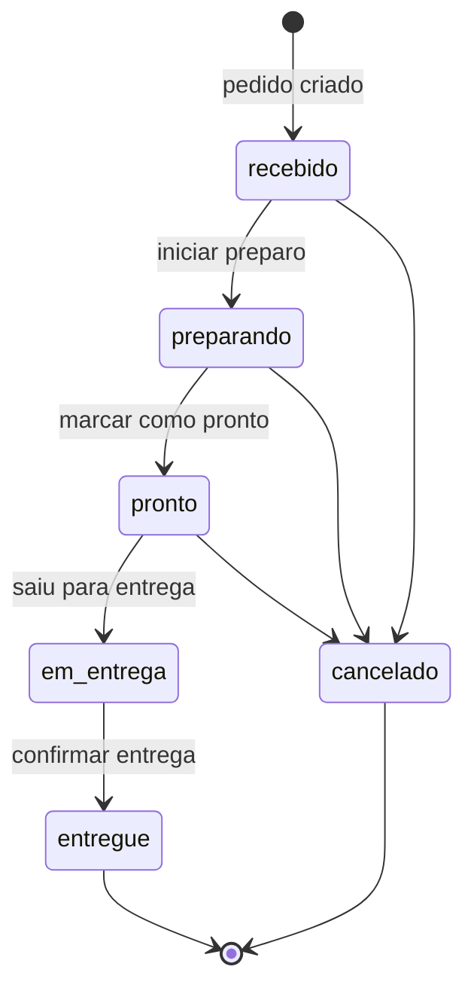
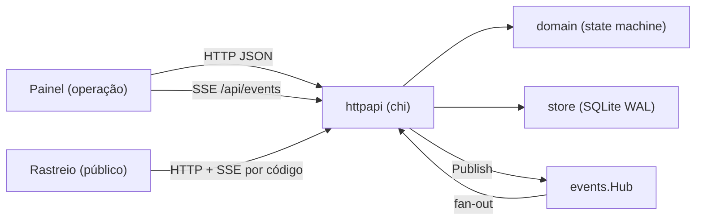

# EntregaViva

Painel de operação para acompanhar pedidos entre restaurante, cozinha e entregadores. O servidor é a autoridade do fluxo de estados, as telas abertas recebem cada mudança em tempo real por Server-Sent Events (SSE) e o cliente final acompanha o pedido por uma página pública que não expõe dados pessoais.

Backend em **Go 1.24**, banco **SQLite** embutido (sem CGO) e frontend estático servido pelo próprio binário — uma única imagem de ~20 MB, sem dependências externas em produção.

## Sumário

- [Visão geral](#visão-geral)
- [Fluxo de estados](#fluxo-de-estados)
- [Tempo real (SSE)](#tempo-real-sse)
- [Rastreio público](#rastreio-público)
- [API](#api)
- [Como rodar](#como-rodar)
- [Variáveis de ambiente](#variáveis-de-ambiente)
- [Estrutura do projeto](#estrutura-do-projeto)
- [Arquitetura e decisões](#arquitetura-e-decisões)
- [Produção](#produção)
- [Limitações conhecidas](#limitações-conhecidas)

## Visão geral

- **Quadro por etapa** — recebido, na cozinha, pronto, em rota e encerrados, com contadores por etapa.
- **Criação, avanço e cancelamento** de pedidos com validação no servidor, confirmação de cancelamento e proteção contra envio duplo.
- **Histórico** de cada mudança de etapa, com horário em UTC.
- **Atualização ao vivo** em todas as telas abertas, com indicador de conexão (conectando, ao vivo, reconectando, sem conexão) e retomada automática.
- **Página de rastreio** (`/track.html`) por código aleatório, com etapas, previsão e histórico — também ao vivo.
- **Tema claro e escuro** (segue o sistema, com alternância manual), layout responsivo até 390 px e foco em acessibilidade.
- **Acesso da operação** opcionalmente protegido por senha (HTTP Basic).

Os dados de exemplo são fictícios. A aplicação não realiza pagamentos nem envia mensagens aos clientes.

## Fluxo de estados

As transições permitidas ficam numa única tabela (`internal/domain/status.go`). Qualquer outra mudança é recusada com `409 Conflict`.



- A atualização roda numa transação e usa `UPDATE ... WHERE id = ? AND status = <anterior>`, então duas sessões nunca sobrescrevem uma à outra sem perceber.
- O painel envia o campo opcional `from` (a etapa que estava na tela). Se o pedido já mudou em outra aba, a resposta é `409` com “O pedido mudou em outra sessão” e o painel se atualiza.
- A previsão é ingênua: `criação + tempo estimado`. `remainingMinutes` nunca fica negativo e `estimatedDeliveryAt` vem em UTC.

## Tempo real (SSE)

| Stream | Quem usa | Conteúdo |
| --- | --- | --- |
| `GET /api/events` | painel da operação | pedido completo a cada mudança |
| `GET /api/orders/track/{code}/events` | página de rastreio | só o pedido daquele código, em versão pública |

Protocolo de cada conexão:

1. `retry: 3000` e o evento `connected`, que já carrega um `id`.
2. `resync` quando o `Last-Event-ID` enviado pelo navegador não pode ser atendido (o servidor reiniciou ou o cliente ficou fora tempo demais). O cliente recarrega o estado completo.
3. Os eventos `order` perdidos durante a queda (reenviados a partir de um buffer circular de 256 eventos), seguidos dos eventos ao vivo.
4. Comentários `: keepalive` a cada `SSE_HEARTBEAT`, para proxies não derrubarem conexões ociosas.

Garantias do hub (`internal/events`):

- `Publish` **nunca bloqueia**: cada cliente tem um buffer limitado. O cliente lento demais é desconectado, reconecta com `Last-Event-ID` e recupera o que perdeu.
- Cada escrita tem deadline próprio (`http.ResponseController`), então um par travado não prende a goroutine.
- O cliente que sai é removido na hora (o teste garante que o número de assinantes volta a zero).
- No `SIGTERM`, `http.Server.Shutdown` fecha o hub (`RegisterOnShutdown`), encerrando todos os streams. O shutdown termina em milissegundos mesmo com telas abertas.
- Os IDs têm o formato `<época>-<sequência>`, assim um ID de outro processo é reconhecido e gera `resync` em vez de uma retomada errada.

## Rastreio público

- O código é aleatório e não sequencial (`EV-XXXX-XXXX`, 8 símbolos de um alfabeto de 30 sem caracteres ambíguos, cerca de 39 bits), gerado com `crypto/rand`. A busca não diferencia maiúsculas de minúsculas.
- A resposta pública **não traz** id interno, cliente, endereço, entregador, valor nem as observações livres da equipe. Traz restaurante, etapa, previsão e o horário de cada etapa.
- As rotas de rastreio têm limite de requisições por IP (`TRACK_RATE_LIMIT`, padrão 60 por minuto), o que dificulta varrer códigos.
- A página aceita `?code=` na URL. O painel mostra o “Link de rastreio” em cada cartão, para enviar ao cliente.

## API

Todas as respostas são JSON (`Content-Type: application/json`). Os erros seguem o formato `{"error": "mensagem", "fields": {"campo": "mensagem"}}` (`fields` só aparece em erros de validação). Os horários seguem a RFC 3339 em UTC.

| Método e rota | Acesso | Descrição |
| --- | --- | --- |
| `GET /api/health` | público | `200 {"status":"ok"}` ou `503` se o banco não responde |
| `GET /api/orders` | operação | pedidos ativos e os 50 encerrados mais recentes, com histórico |
| `POST /api/orders` | operação | cria um pedido (`201`) |
| `PATCH /api/orders/{id}/status` | operação | muda de etapa: `{"status", "note"?, "from"?}` |
| `GET /api/events` | operação | SSE do painel |
| `GET /api/orders/track/{code}` | público | visão pública do pedido |
| `GET /api/orders/track/{code}/events` | público | SSE público do pedido |

Exemplo de criação (`total` em reais; também aceita string, como os formulários enviam):

```bash
curl -X POST http://localhost:3003/api/orders \
  -H 'Content-Type: application/json' \
  -d '{"restaurant":"Casa do Bento","customer":"Marina Lopes","address":"Rua das Flores, 245","courier":"Rafa","total":54.9,"estimatedMinutes":45}'
```

Regras de validação: restaurante e cliente com 3 a 70 caracteres, endereço com 3 a 140, entregador com até 70, valor entre R$ 1,00 e R$ 5.000,00, tempo entre 10 e 180 minutos (padrão 45), observação com até 200 caracteres. As rotas de escrita exigem `Content-Type: application/json` (`415` caso contrário).

Códigos de status: `400` validação ou JSON inválido, `401` sem credencial da operação, `404` pedido ou rota inexistente, `409` transição inválida ou conflito de concorrência, `413` corpo maior que 20 KB, `429` limite de rastreio, `503` banco indisponível ou limite de streams atingido.

## Como rodar

Requer Go 1.24+ (ou apenas Docker).

```bash
make run            # http://localhost:3003 (pedidos de exemplo são criados no banco vazio)
make test           # go test -race ./...
make lint           # gofmt, go vet e golangci-lint
make build          # binário estático em bin/entregaviva
```

Com Docker:

```bash
docker compose up --build          # http://localhost:3003, dados no volume entregaviva-data
cp .env.example .env               # opcional: senha da operação, logs etc.
```

O banco local fica em `data/orders.sqlite`. Bancos criados pela versão anterior em Node.js são migrados automaticamente.

## Variáveis de ambiente

| Variável | Padrão | Descrição |
| --- | --- | --- |
| `PORT` | `3003` | porta HTTP |
| `HOST` | *(todas)* | interface de escuta |
| `DATABASE_PATH` | `data/orders.sqlite` | arquivo SQLite (`/data/orders.sqlite` na imagem) |
| `LOG_LEVEL` | `info` | `debug`, `info`, `warn` ou `error` |
| `SEED_DEMO` | `true` | cria os pedidos de exemplo quando o banco está vazio |
| `OPERATOR_USER` | `operacao` | usuário do acesso da operação |
| `OPERATOR_PASSWORD` | *(vazio)* | ativa o HTTP Basic no painel e na API da operação (mínimo de 12 caracteres) |
| `TRUST_PROXY` | `false` | usa `X-Forwarded-For` e `X-Forwarded-Proto` (só atrás de um proxy confiável) |
| `SSE_HEARTBEAT` | `20s` | intervalo do keepalive |
| `SSE_MAX_CLIENTS` | `500` | máximo de streams simultâneos (`503` acima disso) |
| `TRACK_RATE_LIMIT` | `60` | requisições de rastreio por IP por minuto (`0` desliga) |
| `SHUTDOWN_TIMEOUT` | `10s` | prazo do shutdown gracioso |

Valores inválidos impedem a inicialização, e a mensagem lista todos os problemas de uma vez.

## Estrutura do projeto

```text
cmd/server/          entrada: servidor, shutdown gracioso e subcomando `healthcheck`
internal/config/     leitura e validação das variáveis de ambiente
internal/domain/     modelo do pedido, tabela de transições, validação e códigos de rastreio
internal/store/      SQLite: migrações embutidas, statements preparados e transações
internal/events/     hub SSE: fan-out sem bloqueio, buffer de replay, limite de clientes
internal/httpapi/    rotas chi, handlers, SSE, middlewares (request id, log, CSP, auth, rate limit)
public/              frontend estático (embutido no binário via embed.go)
```

## Arquitetura e decisões



**Por que Go.** O núcleo do produto é manter muitas conexões SSE abertas e repassar eventos sem atrasar ninguém. Goroutines e channels tornam isso simples e barato, `net/http` já traz deadlines por escrita, flush e shutdown gracioso, e o resultado é um binário estático sem runtime para instalar — o que dá uma imagem distroless pequena, inicialização instantânea e uma superfície de ataque mínima. A tipagem estática e o `-race` nos testes dão segurança à parte concorrente.

Outras decisões:

- **SQLite com `modernc.org/sqlite`** (Go puro, sem CGO): o volume de escrita de uma operação de restaurante cabe com folga. Usa WAL, um pool de escrita com uma conexão e `BEGIN IMMEDIATE` (o SQLite só aceita um escritor) e um pool só de leitura, que roda em paralelo às escritas.
- **Migrações versionadas e embutidas** (`internal/store/migrations/*.sql`), aplicadas em transação e registradas em `schema_migrations`. A primeira é compatível com o esquema antigo do Node, e a segunda normaliza os horários para RFC 3339 UTC.
- **Domínio sem dependências**: a tabela de transições e os erros tipados (`TransitionError`, `ValidationError`) são testados isoladamente. As mensagens em português ficam na camada HTTP.
- **SSE em vez de WebSocket**: o fluxo é do servidor para a tela, as ações usam HTTP comum, e o navegador já faz a reconexão com `Last-Event-ID`.
- **O painel aplica o evento direto**, sem buscar de novo a lista inteira. A quantidade de eventos no histórico funciona como versão, para que um snapshot antigo nunca sobrescreva um mais novo.
- **Segurança**: CSP estrita sem scripts nem estilos inline (`script-src 'self'`), `nosniff`, `frame-ancestors 'none'`, `Referrer-Policy: no-referrer`, HSTS atrás de TLS, escape de todo HTML interpolado no frontend, corpo limitado a 20 KB, JSON obrigatório nas escritas (barra posts de formulário cross-site) e comparação da senha em tempo constante.
- **Observabilidade**: logs JSON (`log/slog`), uma linha por requisição com `request_id` (reaproveita o `X-Request-Id` recebido, quando bem formado), status, bytes, duração e IP. Panics são recuperados e registrados com stack.

## Produção

- Imagem `gcr.io/distroless/static-debian12:nonroot`: usuário 65532, sem shell, volume `/data` e `HEALTHCHECK` com `/entregaviva healthcheck`. Também roda com `--read-only`.
- Coloque atrás de um proxy com TLS (Caddy, Nginx, Traefik) e use `TRUST_PROXY=true`. Para SSE, desative o buffering do proxy (o servidor já envia `X-Accel-Buffering: no`) e aumente o timeout de leitura para mais que `SSE_HEARTBEAT`.
- Defina `OPERATOR_PASSWORD` e `SEED_DEMO=false`.
- Backup: o banco é um arquivo único. Use `sqlite3 orders.sqlite ".backup backup.sqlite"` ou um snapshot do volume.
- Use `GET /api/health` nas probes de liveness e readiness.
- O CI roda gofmt, vet, golangci-lint, `go test -race`, o build da imagem e um smoke test do container (healthcheck, criação, rastreio e shutdown gracioso).

## Limitações conhecidas

- **Uma instância só**: o hub SSE fica em memória. Para escalar horizontalmente, seria preciso um barramento (Postgres `LISTEN/NOTIFY`, Redis, NATS) e um banco compartilhado.
- O acesso da operação é uma senha única (HTTP Basic), sem perfis nem auditoria por usuário.
- A previsão de entrega é estimada a partir da criação, não um ETA baseado em trânsito ou localização.
- A lista do painel traz só os 50 pedidos encerrados mais recentes, e não há busca nem paginação de histórico.
- As fontes vêm do Google Fonts. Sem acesso a elas, a página usa as fontes do sistema.
- Bancos do Node anteriores à coluna `estimated_minutes` precisam ter sido abertos pela última versão em Node antes da migração.

## Próximas melhorias

Login por perfil, catálogo de itens, mapa de entregadores, notificações ao cliente e um barramento de eventos para várias instâncias.
